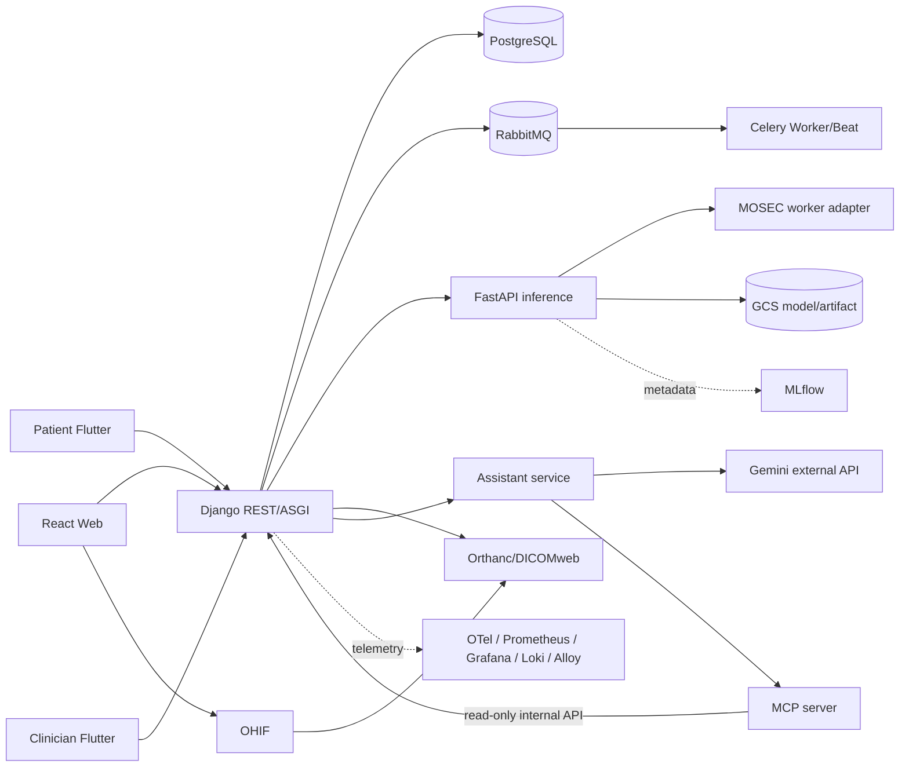

# BrainOn CDSS

BrainOn CDSS는 진료 workflow, 의료영상 AI 결과, 약물 안전성, 알림과 보조 AI를 연결하는 뇌혈관질환 CDSS 모노레포다. Django Backend에서는 인증·RBAC, DUR 연동, 약물안전성 검사, 비동기 작업 및 CDS Hooks 등 핵심 기능을 실제 구현하고 있으며, 영상 AI 추론과 일부 외부 시스템 연동은 별도 구현 단계로 관리한다.

## 기술 스택과 서비스

| 영역 | 기술 | 책임 |
|---|---|---|
| 의료진 웹 | React, Vite, TypeScript | App shell, backend API 소비, 향후 OHIF/Three.js/WebXR 연결 |
| 환자 모바일 | Flutter | 환자 self-service, 알림과 assistant 연결 지점; 독립 배포 |
| 의료진 모바일 | Flutter | 의료진 workflow와 응급 알림 연결 지점; 독립 배포 |
| Backend | Django, DRF, JWT, Celery | modular monolith, RBAC, REST, 알림, 업무 orchestration |
| 추론 | FastAPI, 향후 MOSEC | 배포용 model adapter, DICOM SEG/SR 결과 경계 |
| Assistant | TypeScript, Genkit/Gemini adapter | 역할별 flow, guardrail, MCP client; browser가 Gemini를 직접 호출하지 않음 |
| Clinical tools | Python MCP adapter | Django 내부 API만 호출하는 조회 전용 tool |
| 기반 | PostgreSQL, RabbitMQ, Orthanc/OHIF, GCS, MLflow, OpenTelemetry/Grafana stack | 저장, event, 영상, artifact, 관측성 |

모델 학습, dataset, experiment는 이 저장소 범위가 아니며 별도 `brainon-model-training` 저장소에서 관리한다.

## 저장소 구조
`frontend/`, `mobile/patient-app/`, `mobile/clinician-app/`, `backend/`, `inference/`, `assistant-service/`, `mcp-server/`는 실행 단위다. 모바일의 검증된 비임상 공통 경계는 `mobile/packages/`에 둔다. `contracts/`는 서비스 간 source of truth, `tools/`는 안전한 운영 CLI, `mocks/`는 외부 연동 대역, `infra/`는 local/template 설정, `tests/`는 횡단 검증, `docs/`는 설계·runbook을 담는다.



## 로컬 시작
1. `Copy-Item .env.example .env`(Linux/macOS: `cp .env.example .env`) 후 TODO 값을 로컬 전용 값으로 바꾼다.
2. 최소 환경: `docker compose up --build postgres rabbitmq backend`.
3. 선택 profile: `docker compose --profile ai --profile imaging --profile assistant up --build`.
4. 웹: `npm --prefix frontend install && npm --prefix frontend run dev`.
5. 환자 모바일: `cd mobile/patient-app && flutter pub get && flutter run`.
6. 의료진 모바일: `cd mobile/clinician-app && flutter pub get && flutter run`.

기본 health는 backend `http://localhost:8080/api/v1/health/`, inference `http://localhost:8100/health`, assistant `http://localhost:8200/health`다. 테스트 명령은 `AGENTS.md`와 각 서비스 README에 있다.

## 구현 상태
Backend에서는 Health endpoint, JWT 인증·RBAC, request_id/trace_id 전파와 Audit 기반, MFDS DUR OpenAPI 연동 및 로컬 기준정보 저장·활성화, RabbitMQ/Celery 비동기 DUR Sync, Medication Safety 검사, RX-004 처방 확정, CDS Hooks Discovery/order-select/order-sign/stroke-patient-view를 구현하였다. 현재 실제 DUR 기준정보 연동 및 검증 범위는 DDI(병용금기)와 DOSE(용량주의)이며, 나머지 약물안전성 Rule은 기준정보 확보 범위에 따라 확장한다. 영상 AI 추론 연동, Orthanc/OHIF 운영 연계, Gemini/FCM 및 일부 외부기관 연동은 계속 구현 중이다.

> 실제 환자정보, 비식별화되지 않은 영상, secret 또는 모델 가중치를 이 저장소에 저장하지 않는다.

## Rust/WASM Medical Viewer Beta

AI 분석 결과 화면에는 운영용 Niivue Viewer와 병렬로 `Rust Viewer Beta`가
제공된다. 두 뷰어는 같은 `analysis_id`와 기존 NIfTI manifest API를 사용하며,
Beta 실패는 기존 Viewer 상태에 영향을 주지 않는다. 이 앱은 별도 URL Router
대신 `AppShell` 메뉴 상태를 사용하므로 Viewer 선택은 분석 화면 내부 탭으로
구현되어 있다.

데이터 경로는 `signed GCS NIfTI → Niivue NVImage parser/img2RAS → Float32Array →
WasmVolume(Vec<f32>) → Rust axial/window-level/overlay → RGBA → Canvas 2D`다.
React는 API, NIfTI 해석, 채널 선택, 입력 이벤트와 Canvas를 담당한다. Rust는
volume 소유권, axial borrow, window/level과 segmentation/probability 합성을
담당한다. volume은 최초 로딩 때 한 번 WASM 메모리로 복사되고 슬라이스 이동은
저장된 volume을 재사용한다. Canvas로 반환하는 slice/RGBA에는 경계 복사가 있다.

로컬 빌드와 실행:

```powershell
# rustup + wasm32-unknown-unknown + wasm-pack 0.15 필요
npm.cmd --prefix frontend run build:rust-viewer
npm.cmd --prefix frontend run dev
```

검증과 benchmark:

```powershell
cargo test --manifest-path rust-viewer/Cargo.toml
npm.cmd --prefix frontend test
npm.cmd --prefix frontend run benchmark:rust-viewer
```

Benchmark 버튼은 현재 브라우저·volume에서 21회 중앙값을 표시한다. 기준 로컬
synthetic Float32 volume(128×128×64)의 2026-09-17 측정값은 다음과 같으며,
환경에 따라 달라진다. 결과에는 JS↔WASM 반환 버퍼 복사 비용이 포함된다.

| Operation | JS | Rust/WASM |
|---|---:|---:|
| Slice extraction | 0.028 ms | 0.022 ms |
| Window / Level | 0.078 ms | 0.105 ms |
| Segmentation RGBA | 0.077 ms | 0.070 ms |
| Probability RGBA + LUT | 0.648 ms | 0.124 ms |
| Full composite RGBA | 0.890 ms | 0.462 ms |

The benchmark first verifies byte-for-byte equality between JavaScript and WASM
outputs, then reports the median of 21 measured runs. The viewer also reports the
latest frame breakdown (WASM, ImageData, Canvas, and total) in the benchmark panel.

Beta v1은 RAS radiological axial view, DWI/ADC 전환, zoom/pan, slice scroll,
window/level, mask/probability 토글과 투명도를 지원한다. Coronal/sagittal MPR,
XAI, annotation, 측정 도구, DICOMweb/PACS와 WebGL/WebGPU renderer는 후속 범위다.
Rust의 RGBA 출력 경계는 향후 WebGL texture upload 또는 WebGPU buffer로 교체할
수 있도록 Canvas 컴포넌트와 분리되어 있다.
