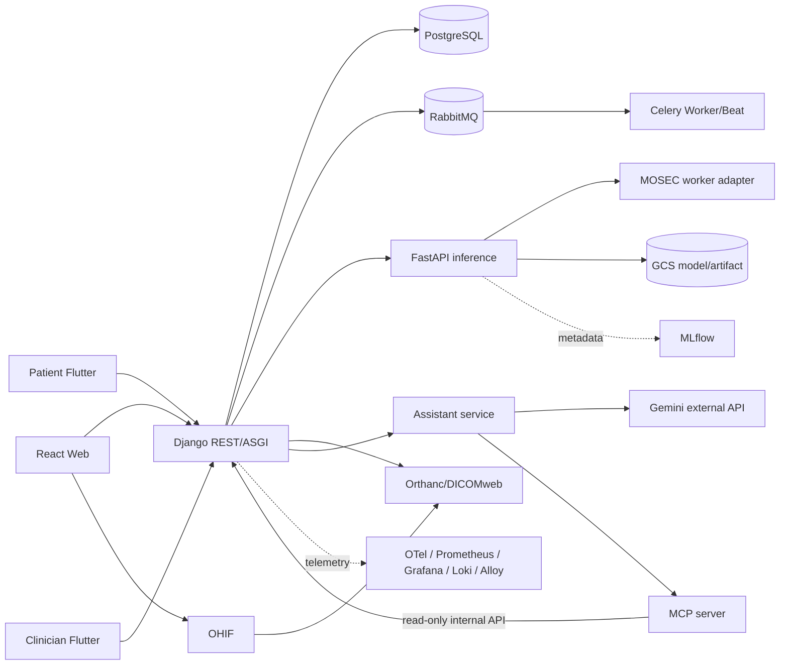

# BrainOn CDSS

BrainOn CDSS는 진료 workflow, 의료영상 AI 결과, 약물 안전성, 알림과 보조 AI를 연결하는 뇌혈관질환 CDSS 모노레포다. Django Backend에서는 인증·RBAC, DUR 연동, 약물안전성 검사, 비동기 작업 및 CDS Hooks 등 핵심 기능을 실제 구현하고 있으며, 영상 AI 추론과 일부 외부 시스템 연동은 별도 구현 단계로 관리한다.

## 기술 스택과 서비스

| 영역 | 기술 | 책임 |
|---|---|---|
| 의료진 웹 | React, Vite, TypeScript | App shell, backend API 소비, 향후 OHIF/Three.js/WebXR 연결 |
| 환자 모바일 | Flutter | 환자 self-service, 알림과 assistant 연결 지점; 독립 배포 |
| 의료진 모바일 | Flutter | 의료진 workflow와 응급 알림 연결 지점; 독립 배포 |
| Backend | Django, DRF, JWT, Celery | modular monolith, RBAC, REST, 알림, 업무 orchestration |
| 추론 | FastAPI, 향후 MOSEC | 배포용 model adapter, DICOM SEG/SR 결과 경계 |
| Assistant | TypeScript, Genkit/Gemini adapter | 역할별 flow, guardrail, MCP client; browser가 Gemini를 직접 호출하지 않음 |
| Clinical tools | Python MCP adapter | Django 내부 API만 호출하는 조회 전용 tool |
| 기반 | PostgreSQL, RabbitMQ, Orthanc/OHIF, GCS, MLflow, OpenTelemetry/Grafana stack | 저장, event, 영상, artifact, 관측성 |

모델 학습, dataset, experiment는 이 저장소 범위가 아니며 별도 `brainon-model-training` 저장소에서 관리한다.

## 저장소 구조
`frontend/`, `mobile/patient-app/`, `mobile/clinician-app/`, `backend/`, `inference/`, `assistant-service/`, `mcp-server/`는 실행 단위다. 모바일의 검증된 비임상 공통 경계는 `mobile/packages/`에 둔다. `contracts/`는 서비스 간 source of truth, `tools/`는 안전한 운영 CLI, `mocks/`는 외부 연동 대역, `infra/`는 local/template 설정, `tests/`는 횡단 검증, `docs/`는 설계·runbook을 담는다.

## 로컬 시작
1. `Copy-Item .env.example .env`(Linux/macOS: `cp .env.example .env`) 후 TODO 값을 로컬 전용 값으로 바꾼다.
2. 최소 환경: `docker compose up --build postgres rabbitmq backend`.
3. 선택 profile: `docker compose --profile ai --profile imaging --profile assistant up --build`.
4. 웹: `npm --prefix frontend install && npm --prefix frontend run dev`.
5. 환자 모바일: `cd mobile/patient-app && flutter pub get && flutter run`.
6. 의료진 모바일: `cd mobile/clinician-app && flutter pub get && flutter run`.

기본 health는 backend `http://localhost:8080/api/v1/health/`, inference `http://localhost:8100/health`, assistant `http://localhost:8200/health`다. 테스트 명령은 `AGENTS.md`와 각 서비스 README에 있다.

## 구현 상태
Backend에서는 Health endpoint, JWT 인증·RBAC, request_id/trace_id 전파와 Audit 기반, MFDS DUR OpenAPI 연동 및 로컬 기준정보 저장·활성화, RabbitMQ/Celery 비동기 DUR Sync, Medication Safety 검사, RX-004 처방 확정, CDS Hooks Discovery/order-select/order-sign/stroke-patient-view를 구현하였다. 현재 실제 DUR 기준정보 연동 및 검증 범위는 DDI(병용금기)와 DOSE(용량주의)이며, 나머지 약물안전성 Rule은 기준정보 확보 범위에 따라 확장한다. 영상 AI 추론 연동, Orthanc/OHIF 운영 연계, Gemini/FCM 및 일부 외부기관 연동은 계속 구현 중이다.

> 실제 환자정보, 비식별화되지 않은 영상, secret 또는 모델 가중치를 이 저장소에 저장하지 않는다.
